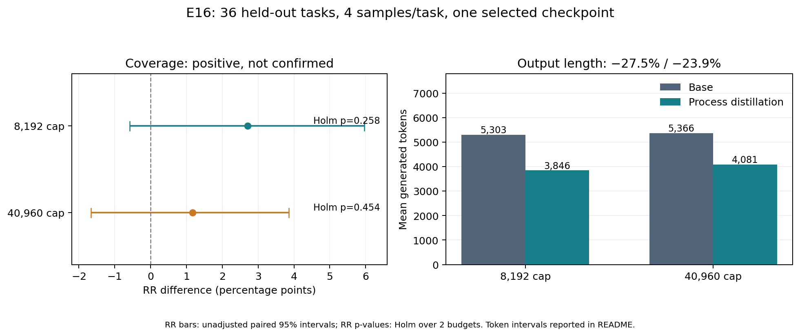

# Qwen3-8B on HypoSpace: Coverage and Reasoning Efficiency

An empirical study of valid-outcome coverage under limited sampling budgets. We evaluated inference settings, GAPO, answer-only and short-explanation SFT, DRP-inspired process distillation, and a teammate's preliminary MS-TTRL adaptation.

**Our primary case study is E16: the first held-out, 36-task confirmation of the selected process-distillation checkpoint.** It provides clear evidence of shorter outputs and a positive, statistically unconfirmed coverage difference. Later negative and inconclusive results remain visible in the [report](docs/REPORT.md) and [timeline](docs/TIMELINE.md).



## Primary result

Qwen3-8B; 48 training families, 144 QA pairs, 72 optimizer updates. The `diverse_w` checkpoint was selected using a separate 12-task development screen before evaluating 36 held-out families, 12 per domain. Thinking is enabled; evaluation uses BF16 merged models, batch size one, and four independent samples per task. The 8,192-token condition is the exact prefix of the corresponding 40,960-token trajectory.

|Generation cap|Model|VR %|NR %|RR@4 %|Mean output tokens|Truncated %|
|---:|---|---:|---:|---:|---:|---:|
|8,192|Base|75.00|40.28|15.57|5,303|6.94|
|8,192|Process distillation|76.39|51.39|18.28|3,846|1.39|
|40,960|Base|80.56|43.75|17.11|5,366|0.00|
|40,960|Process distillation|76.39|52.08|18.28|4,081|0.69|

- **At 8,192: 27.5% fewer output tokens; RR increases numerically by 2.71 percentage points.** The paired 95% bootstrap interval for the token difference is [−1,671, −1,245]. The RR interval is [−0.59, +5.96] pp; Holm-adjusted p=0.258 across the two budget comparisons.
- **At 40,960: 23.9% fewer tokens; RR increases numerically by 1.17 pp.** Token difference interval: [−1,714, −673]; RR interval: [−1.66, +3.86] pp; adjusted p=0.454.
- Output reduction is supported; **a stable coverage improvement is not established**. Token intervals are unadjusted secondary analyses. This is one trained checkpoint, not a multi-training-seed claim. Token savings are not a measured equal-time or equal-total-token coverage gain.
- A later 96-task, three-training-seed expansion did not establish an additional benefit. It is reported alongside E16 rather than suppressed.

## Recompute the result on CPU

```bash
python -m venv .venv
source .venv/bin/activate
pip install -r requirements-analysis.txt
python src/analyze.py
```

No GPU, model weights, or paid API is needed. This checks 144 task-level score records, four cell means, paired intervals, and Holm-adjusted RR tests. See [reproduction instructions](docs/REPRODUCE.md) for canonical re-parsing, prefix verification, retraining, and GPU evaluation.

## Contents

- `results/e16/`: frozen tasks and complete GT, 144 score records, 288 raw long trajectories, statistics, and training logs.
- `data/sft_data_diverse.json.gz`: the actual 576 ordered tokenized examples: 144 QA pairs expanded over four logical epochs.
- `src/`: analysis, strict GT scoring, the weighted training objective, and portable training/merging/generation entry points.
- [Report](docs/REPORT.md), [timeline](docs/TIMELINE.md), and [four-speaker presentation script](docs/PRESENTATION.md).
- [MS-TTRL stage report](docs/MS_TTRL_STAGE.md): teammate-reported findings; incomplete evaluation and replication are explicitly marked.
- `results/secondary/`: development screening, initial DRP results, aggressive-LR failures, and the later 96-task test.
- [Verification record](docs/VERIFICATION.md) and [source/license boundaries](THIRD_PARTY.md).

Data cutoff: 25 November 2026. No credentials, server addresses, model or adapter weights are included. Stored trajectories support verification; new training/generation is not guaranteed bitwise identical across hardware and software. RR values from different task difficulties or sampling budgets are not a single progress curve.
