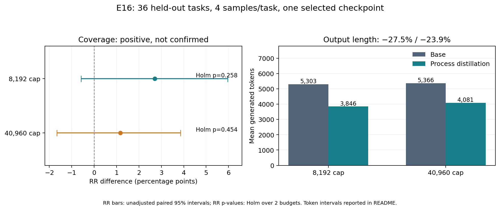

# Coverage and reasoning efficiency on HypoSpace

## Research question

Can parameter-efficient adaptation help Qwen3-8B recover more **distinct valid mechanisms**, rather than repeatedly producing one correct answer, under a fixed candidate budget?

[HypoSpace](https://arxiv.org/abs/2510.15614) generates observations from finite mechanism spaces and enumerates compatible ground truth. Tasks involve causal DAGs, 3D structures, and Boolean expressions. The pipeline is task/GT generation → prompt and optional history → sampling → parsing → validation → canonical deduplication → task scores → aggregation.

Our later strict IID protocol defines VR as valid samples/N, NR as distinct parseable outcomes/N (including invalid ones), and RR@N as distinct recovered GT mechanisms divided by the complete GT set size. Mechanistic identity is not arbitrary Boolean functional equivalence. Split by task family before constructing multiple answers, and compare conditions on the same tasks and sampling settings.

## Primary result: E16

### Method

Inspired by [DRP](https://aclanthology.org/2026.findings-acl.196/), a teacher edits student reasoning; we add mechanism-preservation checks and targeted multi-outcome augmentation. This includes repair and augmentation, not only deletion, and is a cross-task adaptation rather than a reproduction of the original math experiments.

Training uses 48 families, 144 QA pairs, four logical epochs, NF4 QLoRA r32/alpha32, LR2e-5, micro-batch1, gradient accumulation8, and 72 updates. End-of-thinking and EOS tokens receive weight3; other supervised assistant tokens receive weight1. The maximum sequence is5,343 with no training truncation. The selected `diverse_w` checkpoint was chosen on a separate12-task development screen and evaluated as a BF16 merged model on36 held-out families,12 per domain, N4, thinking enabled.

|Cap|Model|VR %|NR %|RR@4 %|Mean tokens|Truncated %|
|---:|---|---:|---:|---:|---:|---:|
|8,192|Base|75.00|40.28|15.57|5,303|6.94|
|8,192|Process distillation|76.39|51.39|18.28|3,846|1.39|
|40,960|Base|80.56|43.75|17.11|5,366|0.00|
|40,960|Process distillation|76.39|52.08|18.28|4,081|0.69|

At8,192, RR increases by2.71pp:11 tasks improve,2 decline,23 tie. Its paired95% interval is[−0.59,+5.96]pp and the two-budget Holm-adjusted p=0.258. Output falls by1,457 tokens (27.5%), with paired interval[−1,671,−1,245]. At40,960, RR difference is+1.17pp, interval[−1.66,+3.86], adjusted p=0.454; output falls23.9%, with token-difference interval[−1,714,−673].

**The supported success is shorter output; coverage improvement remains a positive but unconfirmed signal.** Length intervals are unadjusted secondary analyses. There is one trained checkpoint, so this is not a cross-training-seed stability claim. Token savings do not directly demonstrate end-to-end latency or equal-total-token coverage improvements.

### What changed across domains?

At8,192, causal RR rises23.06→26.79 and Boolean8.20→12.61, while3D remains15.43→15.43. Yet3D VR rises85.42→97.92: more valid samples need not mean more distinct valid mechanisms. Extending the cap rescues eight valid Base candidates and no new valid distilled-model candidates. Truncation is therefore only part of the explanation.

Our working interpretation is that process editing reduces repetition and ending failures, while multi-outcome targets may reduce simple-answer bias. However, process category, target distribution, ending supervision, and other factors change together. We cannot uniquely attribute the result to pruning, target diversity, or one token weight.

## Historical attempts and their evidence

Dates and report outputs are mapped in the [timeline](TIMELINE.md). The table distinguishes measured outcomes from explanations.

|Attempt and reference|Implementation|Observed outcome|Interpretation and boundary|
|---|---|---|---|
|Inference settings; HypoSpace and DSH engineering baseline|8B/27B × thinking on/off × direct/default DSH, eight conditions; no tools/network|Early8B direct thinking RR: causal87.50,3D62.96, Boolean46.14; default DSH gives no stable advantage|8B has useful headroom. Successful DSH candidates usually execute one model step; this does not reject all iterative search. EarlyN=GT differs from laterN4.|
|GAPO prototype; Anschel et al., EMNLP2025|NF4, G8,20-step probes; memory and update checks|Updates run; duplicate groups can have zero advantages. An old Boolean family leak was corrected.|Engineering feasibility is not held-out improvement; a leakage fix is not an algorithmic gain.|
|GAPO list-task mechanism replication; same paper|Teammate BF16 LoRA, G32,200 updates, three training seeds; thinking disabled during training|Distinct valid answers: Base1.354 versus GAPO2.594–2.813; JSD ratio0.9283 versus0.6640–0.6992|Frequency rewards change the list-output distribution. Ranges are seed-mean ranges, not CIs; this does not establish HypoSpace transfer.|
|Direct HypoSpace RL; GAPO versus validity-only reward|24 train/6 validation/9 test; NF4r32, G8, thinking8K,40 updates per arm|Domain-macro RR: Base18.77, validity15.09, GAPO18.74|GAPO beats validity control but not Base; only three independent test tasks/domain. Sparse support and complex constraints are possible limits, not proven causes.|
|Answer-only and short-teacher SFT; general reasoning-distillation motivation|96 families/288 QA, two72-step models;18-taskN8 development evaluation|Base VR/RR76.39/14.77; GT59.03/14.21; short teacher36.11/14.55; tokens5,233→63/206|Shortness can suppress useful checks. The teacher target is short content, not full reasoning_content; process mismatch is a hypothesis.|
|Visible-reasoning audit; process-supervision motivation|Translate and check independently sampled traces of the same task|Repetition, faulty intermediate deductions, and simplest-answer preference occur even with correct final answers|Three selected cases illustrate mechanisms, not population error rates; no hidden-state causal analysis or PRM training was performed.|
|Initial DRP adaptation; Jiang et al., Findings ACL2026|48 admitted tasks,416 source candidates; GT/core/diverse arms,36 updates each;18-taskN8 evaluation|Base VR/RR76.39/16.68; core46.53/13.77; diverse38.19/14.62|Shorter traces did not preserve validity. Over-pruning, ending behavior, deployment precision, and target mismatch motivated subsequent diagnostics.|
|Precision bridge and nine-arm diagnosis; DRP-inspired/custom ablations|NF4/BF16 bridge; raw/aggressive/conservative/diverse × ending weights1/3, plusGT|Small bridge: EOS without closed think25%→0. On12 dev tasks, diverse_w RR16.95 versus Base11.80|Deployment changes can alter output behavior. The small multi-arm screen selects a checkpoint; it is not held-out confirmation.|
|E16 held-out confirmation; primary method|48-family checkpoint,36 test tasks, paired caps|Tokens−27.5%/−23.9%; RR+2.71/+1.17pp|Efficiency evidence with an unconfirmed coverage signal.|
|LR/answer-weight sweep; custom ablation|Fixed48 families, LR2e-5/5e-5/1e-4 × answer weights1/2/4; end weight3|Best old18-task dev RR only about+0.09pp over Base; highLR causes empty thinking or long tails|A largerLR is not a general remedy for insufficient training.|
|Expansion; custom scale test|Add six-variable causal tasks;192 families,756 QA,384 updates; nine configs plus two seed replications|On96 new tasks, three-seed mean RR is slightly above Base but not significantly so, and does not exceed the old48-family model|Data size, step count, and target distribution change together; this does not show that more data is universally ineffective.|
|Preliminary MS-TTRL; Zhang et al.,2026 preprint|Teammate same-policy voting, three-state cache, frequency reward, GRPO; seed1337, epoch10|Two-domain18-task VR improves, but RR does not beat Base;3D held-out evaluation pending|Verification cost and protocol alignment require separate analysis; this is not a completed paper reproduction.|

References: [GAPO](https://aclanthology.org/2025.emnlp-main.1649/), [DeepSeek-R1](https://arxiv.org/abs/2501.12948), [Let's Verify Step by Step](https://arxiv.org/abs/2305.20050), [DRP](https://aclanthology.org/2026.findings-acl.196/). Short explanations and the specific diagnostic design are our engineering choices, not claims copied from those papers.

## Later expansion and parameter boundaries

With LR1e-4/answer weight2, all24 evaluated3D samples contain empty thinking and19/24 have incorrect projections. With the sameLR/answer weight1,3D averages21,261 tokens and45.83% reaches40K. Both incorrect short answers and extended incorrect reasoning can result from aggressive training.

Only73 independent GT-isomorphism classes exist for the five-variable causal setup. We added six variables, enumerated3,781,503 DAGs, and split by isomorphism. Expanded training:192 families,756 unique QA,384 updates. A new96-task test has32 tasks/domain, N4, three selected training seeds, BF16 batch1, and paired caps.

|Cap|Model|VR %|RR@4 %|Mean tokens|
|---:|---|---:|---:|---:|
|8,192|Base|87.76|12.90|5,039|
|8,192|Previous48-family|84.90|14.96|3,707|
|8,192|Old48-family sweep best|86.20|14.88|3,747|
|8,192|Expanded192-family,3-seed mean|85.33|14.37|4,077|
|40,960|Base|91.93|13.01|5,085|
|40,960|Previous48-family|84.90|14.96|4,134|
|40,960|Old48-family sweep best|86.46|14.88|4,004|
|40,960|Expanded192-family,3-seed mean|85.76|14.41|5,047|

Expanded-versus-Base RR differences are+1.47/+1.40pp; six-comparison Holm-adjusted p=0.113/0.130. Differences versus the old sweep best are−0.52/−0.48pp, also not confirmed significant. At40K, token savings nearly vanish; extra length adds only about0.04pp RR. These results constrain the interpretation of E16 and must remain disclosed.

## MS-TTRL stage attempt

The [paper](https://arxiv.org/abs/2610.32234) separates correctness estimation from generation frequency. Our teammate's current stage uses24 training tasks, eight/domain, and has completed18 Boolean/Causal evaluation tasks at epoch10, seed1337. See the [stage report](MS_TTRL_STAGE.md).

|Two domains,18 tasks|VR %|NR %|RR@4 %|
|---|---:|---:|---:|
|Base|91.67|37.50|19.82|
|Majority TTRL|90.28|40.28|20.41|
|MS-TTRL|94.44|34.72|19.66|

MS produces two more valid samples than Base overall, but RR falls0.16pp. Boolean validity rises while coverage falls. Causal's mean RR gain is strongly influenced by one task; three of the other seven tie and four decline. Training time is5.6×/10.1× the majority baseline for Boolean/Causal. On41 observed3D training candidates, representation/parsing revisions improve confirmation of valid structures4→24 out of26; this is not independent-test evidence.

Reproduction gaps remain unresolved. The paper publicly specifies important settings, includingG8, LR1e-6, batch16 prompts, response cap1024,20/30 epochs, and larger training splits. Its evaluation k differs fromN4. The current [official README](https://github.com/zzx-peter/Multiple-Solution-TTRL) excludes unparseable verifier responses from the denominator; the teammate pilot uses a fixed denominator8. Boolean grammar/GT scope also differs. Missing public details are a hypothesis to investigate, not an established explanation that replaces these known discrepancies.

## What the problem is really about

For one task with L GT mechanisms, let p_k be the probability that an IID sample produces mechanism k:

`E[RR@N] = (1/L) * sum_k [1 - (1 - p_k)^N]`.

This explanatory model applies to the later IID protocol, not the original history-conditioned loop. It exposes three distinct bottlenecks:

1. **Insufficient valid mass:** improving VR puts more probability inside the legal space, but may repeatedly hit the same mechanism.
2. **Concentration within the valid space:** high VR can coexist with low RR. Frequency rewards reshape sampled support; shortening a trace for the same answer does not create a new mechanism.
3. **High cost per sample:** process editing can reduce token cost, but equal-budget coverage improves only if legality is preserved and saved budget buys useful extra sampling. We have not completed that comparison.

Rewards can reweight observed answers but cannot automatically provide reasoning for never-sampled valid outcomes. Teachers can expand target support, but may also transmit errors or simple-answer bias. Self-verification adds another risk: rare is not necessarily correct, and confident cached judgments are not the same as strict GT membership.

The central lesson is to control **process efficiency, validity, outcome diversity, and scoring semantics separately**. List-task gains do not guarantee structural-task transfer. Development gains do not replace held-out confirmation. E16 supports process-editing research, not the claim that shorter reasoning always improves coverage.

## Contributions and remaining controls

We contribute a verified local8B baseline, strictGT/family-isolated evaluation, reward-transfer and distillation comparisons, a36-task efficiency result with bounded coverage claims, and transparent later failures/inconclusive tests. Frozen tasks, raw token trajectories, task-level scores, and CPU analysis are provided.

Unperformed routes are not counted as failed experiments: same-QA unpruned student-CoT control, same-size192-familyGT-only control, equal-total-token/equal-time resampling, PRM training, online distillation, hidden-state intervention, and prompt inversion. The next discriminating experiments should match total cost and separate process editing from multi-outcome target construction.
